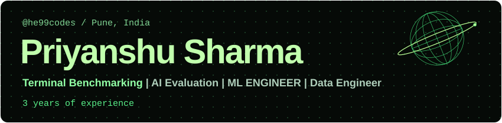
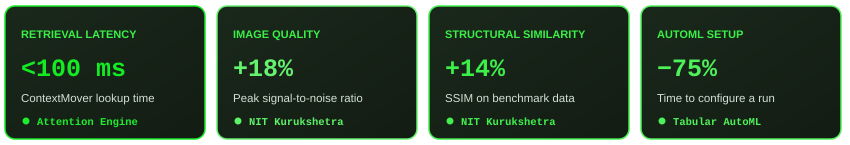
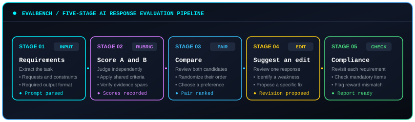

  
  
  

I’m **Priyanshu Sharma**, a Computer Science Engineering student at **Bharati Vidyapeeth College of Engineering, Pune** (B.Tech, expected May 2027). I have **3 years of experience** building software and working with machine learning. I build ContextMover, design terminal benchmarks for coding agents at Handshake AI, and study how deep learning models restore images.

[GitHub](https://github.com/he99codes) · [LinkedIn](https://www.linkedin.com/in/priyanshu-sharma-0bb566281/) · [Email](mailto:priyanshu2164@gmail.com)

## Experience

**AI Fellow · Handshake AI** · July 2026–present
My work focuses on **terminal benchmarking**. I design multi-step coding and reasoning tasks, then tune their difficulty to see where an agent loses track of its goal while exploring an unfamiliar environment.

**Application Developer · ContextMover** · April 2026–present
I built a Chrome extension, a React Native Android app, and an Express backend to keep context in sync across devices. Redesigning the lookup index brought retrieval below 100 ms. A fallback for low-spec hardware cut failures and timeouts by 35%. [ContextMover](https://github.com/he99codes/ContextMover)

**Research Intern · National Institute of Technology, Kurukshetra** · February–May 2026
I built and validated CNN, GAN, and diffusion pipelines in Python. On benchmark datasets, the experiments improved peak signal-to-noise ratio (PSNR) by 18% and structural similarity (SSIM) by 14%.

## Selected projects

**Tabular AutoML.** I built a Python workflow that uses Bayesian optimization to tune models and SHAP to explain predictions. The framework reduced setup time by 75% and improved model performance by 8%. [Tabular AutoML](https://github.com/he99codes/tabular-autoML)

**EvalBench.** This workbench compares two AI responses against a shared rubric and ties each score to a passage in the answer. [EvalBench](https://github.com/he99codes/evalbench)

## Tools and training

I work in Python, C++, JavaScript, TypeScript, SQL, and Bash. I use PyTorch and TensorFlow for deep learning, and React, React Native, and Node.js for application development.

I completed the **Machine Learning**, **Deep Learning**, and **Mathematics for Machine Learning and Data Science** specializations from DeepLearning.AI through Coursera.

## GitHub activity

  
  

  
  

