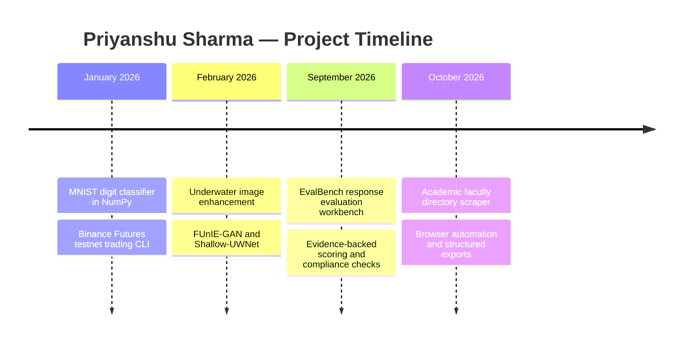

<!-- Profile layout inspired by https://github.com/faisal37990/faisal37990 -->

  

  

  <strong>Pune, India 🇮🇳</strong> &nbsp;|&nbsp;
  <strong>Computer Science Student</strong> &nbsp;|&nbsp;
  <strong>Underwater Image Restoration &amp; AI Response Evaluation</strong>

  
  
  
  
  

  
  
  
  
  

  

  

---

### 🌟 Executive Overview

> I’m **Priyanshu Sharma**, a computer science student in Pune. My research starts with a question about underwater photographs. When the water absorbs red light and distant objects lose contrast, what can an image restoration model recover? I’m exploring that question with **Restormer**, **FUnIE-GAN**, and **Shallow-UWNet**.
>
> I also built **EvalBench** to compare two AI responses to the same prompt. Each score points to a passage in the answer, so a reviewer can inspect the evidence behind a preference. For a closer look at how models learn, I wrote a digit classifier in **NumPy**, including the forward pass and gradients.

---

### 🎭 Core Multi-Disciplinary Profiles

<table>
  <tr>
    <td width="50%" valign="top">
      <h4>🌊 Underwater Computer Vision</h4>
      <ul>
        <li><strong>Restormer</strong> is the transformer architecture I’m exploring for underwater image restoration.</li>
        <li><strong>FUnIE-GAN</strong> uses a generator and discriminator to learn how to enhance degraded frames.</li>
        <li><strong>Shallow-UWNet</strong> gives me a lightweight convolutional approach to compare with the GAN.</li>
        <li><strong>RUIE</strong> provides real underwater scenes with varying visibility and color casts.</li>
      </ul>
    </td>
    <td width="50%" valign="top">
      <h4>🎯 AI Response Evaluation</h4>
      <ul>
        <li><strong>Requirement extraction</strong> identifies requests, constraints, and formatting rules in a prompt.</li>
        <li><strong>Independent scoring</strong> gives each candidate the same rubric and verifies quotes against the response text.</li>
        <li><strong>Pairwise comparison</strong> randomizes the answer order before the evaluator picks a preference.</li>
        <li><strong>Compliance checks</strong> flag cases where the favored answer misses a mandatory requirement.</li>
      </ul>
    </td>
  </tr>
  <tr>
    <td width="50%" valign="top">
      <h4>🧠 Machine Learning from Scratch</h4>
      <ul>
        <li><strong>MNIST</strong> turns each 28 × 28 grayscale image into 784 inputs and predicts one of ten digits.</li>
        <li><strong>NumPy</strong> handles the matrix operations for the forward pass and backpropagation.</li>
        <li><strong>ReLU and softmax</strong> connect the hidden layer to the ten output probabilities.</li>
        <li><strong>Training experiments</strong> use L2 regularization and learning-rate decay.</li>
      </ul>
    </td>
    <td width="50%" valign="top">
      <h4>⚙️ Embedded Systems &amp; Hardware Security</h4>
      <ul>
        <li><strong>Digispark ATtiny85</strong> is the board I used to build a USB keystroke-injection demo.</li>
        <li><strong>USB HID</strong> interests me because a host can interpret a small peripheral as a keyboard.</li>
        <li><strong>Arduino and ultrasonic sensing</strong> powered my obstacle-avoiding robot.</li>
        <li><strong>Firmware development</strong> is an area I’m studying alongside embedded security.</li>
      </ul>
    </td>
  </tr>
  <tr>
    <td colspan="2" valign="top">
      <h4>📊 Web Automation &amp; Data Extraction</h4>
      <ul>
        <li><strong>Faculty directory discovery</strong> starts with an institution name and finds its departments and leadership pages.</li>
        <li><strong>Playwright</strong> renders JavaScript directories so the scraper can inspect staff cards and tables.</li>
        <li><strong>Structured exports</strong> preserve names, roles, and institutional context in JSON, JSON Lines, or CSV.</li>
      </ul>
    </td>
  </tr>
</table>

---

### ⚡ Live Architecture · EvalBench Evaluation Pipeline

  

---

### 🛠️ Interactive Tech Stack Arsenal

  

#### 💻 Computer Vision & Deep Learning

  
  
  
  
  
  

#### 🎯 AI Evaluation & Web Automation

  
  
  
  
  
  

#### ⚙️ Embedded Systems & Developer Tools

  
  
  
  
  
  

#### ⚡ Languages & Interfaces

  
  
  
  
  
  
  
  

---

### 💼 Research & Project Journey

#### 🏛️ Project Results

- 🧠 **About 90% development accuracy** on MNIST with a neural network implemented in NumPy. [Training results](https://github.com/he99codes/mnist-neural-network#results)
- 🎯 **Five evaluation stages** take EvalBench from a user prompt to a report with evidence for each score. [Pipeline](https://github.com/he99codes/evalbench/blob/main/docs/OVERVIEW.md)
- 🔎 **Three export formats** make the same faculty records available to scripts, streaming consumers, and spreadsheets. [Directory scraper](https://github.com/he99codes/academic-faculty-scraper)
- 📈 **Five order types** are available in my Binance Futures testnet CLI, including grid and time-weighted orders. [Trading bot](https://github.com/he99codes/Priyanshu-Trading-Bot)
- 🔐 **An ATtiny85 USB demo** let me test how a microcontroller presents itself to a host as a keyboard.

---

### 🚀 Featured Flagship Repositories

| Project | Focus Area | Technologies | GitHub Link |
| :--- | :--- | :--- | :--- |
| **`evalbench`** | **🎯 Pairwise AI response evaluation** | FastAPI, React, PostgreSQL |  |
| **`mnist-neural-network`** | **🧠 Handwritten digit recognition** | Python, NumPy, Jupyter |  |
| **`academic-faculty-scraper`** | **🔎 Faculty directory extraction** | Python, Playwright, Pydantic |  |
| **`Priyanshu-Trading-Bot`** | **📈 Order execution on a futures testnet** | Python, Binance Futures API |  |

---

### 🌐 Open Source Footprint & Ecosystem Connections

My public forks collect models, datasets, and tools I study. The underwater vision repositories below cover three enhancement architectures and a benchmark built from real underwater images.

  
  
  
  

  
  
  
  
  
  
  
  

---

### 📈 Dynamic Analytics & GitHub Telemetry

  
  

  
  

  

  

---

### 💬 Connect & Collaborate

If you’re comparing underwater restoration models or designing a rubric for AI responses, I’d like to hear what you’re testing.

  
  
  

  

